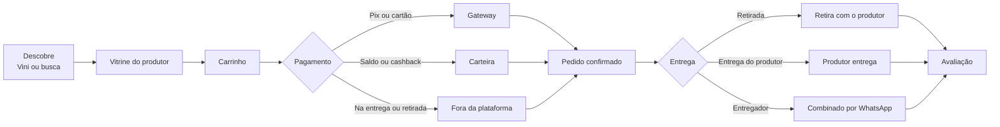
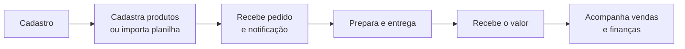
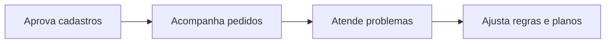

# Mapa da ideia: Vitrinei

Fontes: `conversas-e-ideias` (requisito em 24 itens e recorte da v1), a conversa com o dev em 26/11/2026 e o diagnóstico do código (`diagnostico-v1.md`). Convenções: `> [!DECISAO]` é o que foi definido na conversa e deve ser confirmado com o Daniel, dono do produto; `> [!CONFIRMAR]` é dúvida em aberto (ver `decisoes.md`). Neste documento, "usuário" é quem usa o app.

## 1. Visão

O Vitrinei é uma plataforma que conecta consumidores a produtores, microempreendedores, autônomos e comerciantes locais. Serve para divulgar, vender, organizar as finanças de quem produz e conectar as pessoas, com um assistente de IA (o **Vini**) para busca e atendimento. A proposta é permitir que qualquer pessoa com um produto de qualidade encontre clientes.

**Público inicial:** quem produz em pequena escala e não tem estrutura para achar clientes: pães recheados, bolos, doces, salgados, farofas, alimentos artesanais e congelados, hortaliças e plantas.

> [!DECISAO] Cidade piloto: **Franca-SP** (definido em 26/11/2026; confirmar com o Daniel).

## 2. Perfis

| Perfil | Dispositivo principal | O que faz | Papel no código | Na v1? |
|---|---|---|---|---|
| Consumidor | Celular | Pesquisa, compra, conversa com o Vini, acompanha pedido | `client` | Sim |
| Produtor / fornecedor | Celular | Cadastra produtos, divulga, vende, controla finanças | `provider`, `mixed` | Sim |
| Gestor / administração | Computador | Acompanha operação, usuários, regras e configurações | `admin`, `master` | Sim |
| Representante comercial | Celular | Indica produtores e consumidores, acompanha resultados | ainda não existe | Não (depois) |
| Entregador | Celular | Entrega pedidos | ainda não existe | Não (depois) |

O consumidor também pode ser produtor (`mixed`). A matriz de permissões está em `src/lib/permissions.ts`.

## 3. Módulos

| Módulo (requisito §6) | Existe no código? | Na v1? |
|---|---|---|
| Clientes | Sim (cadastro, perfil, carteira) | Sim |
| Produtores e fornecedores | Sim (vitrine, importação em massa, estoque) | Sim |
| Marketplace (busca, categorias, vitrine) | Sim, misturado com dados fictícios | Sim, só produtos |
| Gestão financeira do produtor | Parcial (`MeiPanel`, carteira) | Sim, versão simples |
| Vini IA | Sim, em texto (voz de entrada parcial) | Sim, só texto |
| Comunicação e pedidos | **Não**: não há pedidos nem chat entre cliente e produtor | Pedidos sim; chat não |
| Assinaturas e benefícios | Sim, sem cobrança real | A definir |
| Indicações e representantes | Indicação simples sim; rede de representantes não | Só indicação simples |
| Administração | Sim (`/admin`) | Sim |

## 4. Jornadas

### Consumidor

### Produtor

### Administração

> [!DECISAO] A operação do dia a dia é feita por Daniel e equipe pelo painel `/admin` (confirmar com o Daniel).

## 5. Escopo: v1 e depois

| Tema | v1 | Depois |
|---|---|---|
| O que se vende | **Só produtos** (alimentos, congelados, itens simples) | Serviços |
| Pagamento | Pix, cartão, saldo/cashback da carteira, pagamento na entrega/retirada | Parcelamento ampliado, outros meios |
| Entrega | Retirada, entrega do próprio produtor, entregador combinado por WhatsApp | Entregador como perfil, rastreio |
| Vini | Conversa em texto | Voz, recomendações avançadas |
| Afiliados | Indicação simples (link/código com cashback) | Representantes, rede, comissões por venda |
| Admin | `/admin` atual com os ajustes necessários | Indicadores, regras comerciais configuráveis |
| Alcance | Franca-SP | Cidades vizinhas, bairros, anúncios patrocinados |

## 6. Tensões a resolver

> [!CONFIRMAR] **Pagamento na entrega/retirada.** Esse pagamento acontece fora da plataforma: não há split nem a taxa de 2% do código. Como o Vitrinei ganha nesses pedidos?

> [!CONFIRMAR] **Cartão.** Exige gateway com cartão e uma regra de parcelamento. Hoje `auth_split_5x` existe, mas nunca é validada.

> [!CONFIRMAR] **Saldo/cashback.** O saldo só vale como forma de pagamento depois que o cashback for definido (decisão aberta).

> [!CONFIRMAR] **Receita da v1.** Taxa por transação, assinatura do produtor e assinatura do consumidor foram citadas na conversa, mas o dev também marcou "ainda não definido". Uma assinatura de consumidor com desconto somada à taxa de 2% pode não fechar a conta; precisa de conta feita.

> [!CONFIRMAR] **Primeiros produtores.** Ainda não se sabe quem são. Sem eles não há catálogo no lançamento. A importação em massa (`/importar`) existe, mas está sem guarda de rota.

## 7. Glossário

| Termo | Significado |
|---|---|
| Vini | Assistente de IA do Vitrinei. Hoje o código orienta o Vini a não se apresentar como IA; isso precisa de confirmação do Daniel e do jurídico (A14 em `decisoes.md`) |
| MEI | Microempreendedor individual |
| Vitrine | Página de loja de um produtor (`/loja/:slug`) |
| Carteira | Saldo interno do usuário (`wallets`) com extrato (`wallet_transactions`) |
| Cashback travado / fracionado | Valor de recompensa retido na carteira e liberado por fases (regras no SQL) |
| Split | Divisão do pagamento entre produtor e plataforma |
| Kit | Conjunto de itens vendido junto (`kits`, `kit_items`) |
| Cardex | Controle de movimentação de estoque (`stock_movements`) |
| Dropship | Venda sem estoque próprio, com o item vindo de outro fornecedor |
| `provider` / `mixed` | Papéis de produtor e de usuário que compra e vende |
